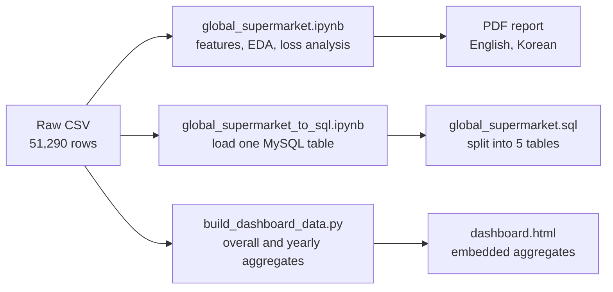
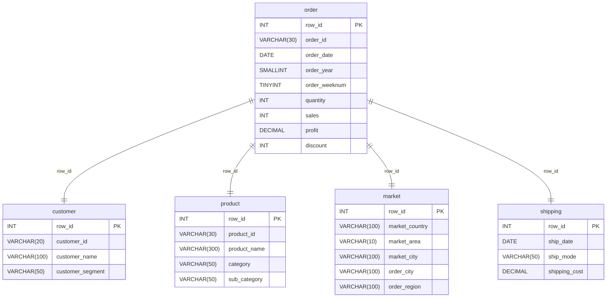

# Global Supermarket Analysis

[Korean](./README_KOR.md)

## Overview

A project that analyzes global supermarket order data from 2019–2022 to find what causes losses and to recommend pricing policies that reduce them.

- **Q1.** What characterizes the customer, order, product, market, and shipping data?
- **Q2.** Which transactions create losses, and what decisions would reduce them?

## Architecture

One raw CSV produces the analysis report, the MySQL tables, and the dashboard.



| Component | Role | Stack |
|---|---|---|
| Analysis notebook | Feature engineering, EDA, loss analysis, discount analysis | Pandas, NumPy, SciPy, Matplotlib, Seaborn |
| SQL | Loads the CSV into MySQL and splits it into five tables | MySQL, PyMySQL |
| Dashboard build | Aggregates the CSV into the HTML and checks the totals | Python standard library |
| Dashboard | Explores the results in a browser | JavaScript, SVG |

In MySQL, the source data is split into five tables by `row_id`.



## Data

The source is `datafile/[DArt-B 5기] Global_Supermarket.csv` at the repository root.

- 51,290 rows and 24 columns, with no missing values or duplicate rows.
- Orders from 2019-01-01 to 2022-12-31, covering 25,035 unique orders and 4,873 customers.
- Seven markets (APAC, EU, US, LATAM, Africa, EMEA, Canada), 147 countries, and 17 sub-categories.
- Each row is one product line within an order, not a whole order.

### Derived Features

| Feature | Formula | Meaning |
|---|---|---|
| `pre_sales` | `sales / (1 − discount)` | Sales before discount |
| `uni_cost` | `pre_sales / quantity` | Pre-discount price per unit (despite the name, not a cost) |
| `eta` | `ship_date − order_date` | Days from order to shipment |

## Method

The analysis surveys the whole dataset first and then narrows down where losses occur.

1. EDA: customers, orders, products, markets, and shipping.
2. Correlation analysis: relationships among continuous variables such as discount, sales, and profit.
3. Loss analysis: profit and loss by sub-category, manufacturer, market, and city.
4. Discount analysis: profit and loss by discount band across markets and sub-categories.

A high discount means a discount above 40% (`discount > 0.4`). Manufacturers are inferred from the first word of the product name.

## Results

| Metric | Value |
|---|---|
| Total sales / profit | $12.64M / $1.47M (11.6% margin) |
| Discount–profit correlation | −0.316 |
| Transactions discounted above 40% | 13.6% of all transactions |
| Their share of losses | 68.2% of total losses |

### Key Findings

1. **Losses concentrate in heavily discounted transactions.** Transactions discounted above 40% are only 13.6% of all transactions but produce 68.2% of total losses, and about 0.02% of total profit.
2. **Tables is the only loss-making sub-category.** Its net loss is about −$64K, led by Bevis, Barricks, and Lesro.
3. **Profit structure differs by region.** Net profit ranks APAC, EU, US, LATAM. In APAC, US, and LATAM, Tables are 6–9% of sales but 18–21% of losses, and 75.6% of EU losses come from discounts of 40–60%.
4. **Volume is growing with clear seasonality.** Transactions grew about 95%, from 8,998 in 2019 to 17,531 in 2022, and peak in September, November, and December.

### Recommendations

| # | Recommendation | Evidence |
|---|---|---|
| 1 | Cap discounts for Phones and Bookcases at 40% | Discounts above 40% cause 68.2% of losses |
| 2 | Lower discounts on high-discount EU products by about 20 percentage points | 75.6% of EU losses come from the 40–60% band |
| 3 | Reduce or discontinue Tables products from Bevis, Barricks, and Lesro | Largest losses in the only loss-making sub-category |
| 4 | Reduce heavy discounts in Istanbul, Lagos, and Texas | The three cities with the largest losses |

## Usage

Run commands from `projects/Global_Supermarket_Analysis`.

### Environment

```bash
pip install -r requirements.txt
```

Tested on Python 3.10 and 3.11.

### Dashboard

`dashboard.html` embeds the aggregated data, so it opens directly in a browser without a server or internet connection. It supports a year filter, chart/table toggles, and monthly CSV export.

```bash
xdg-open dashboard.html                            # Open the dashboard (open on macOS)
python3 dashboard_build/build_dashboard_data.py    # Re-aggregate after the source CSV changes
python3 -m unittest discover -s dashboard_build    # Check the aggregates against the source CSV
```

Metric definitions are in [dashboard_build/README.md](./dashboard_build/README.md).

### Notebooks

```bash
jupyter notebook global_supermarket.ipynb
```

- The analysis notebooks read the CSV from GitHub by URL, so they need an internet connection.
- To run `global_supermarket_to_sql.ipynb`, copy `.env.example` to `.env` and fill in the MySQL connection details. After loading, split the tables with [global_supermarket.sql](../../SQL/global_supermarket/global_supermarket.sql).

## Repository Structure

```
Global_Supermarket_Analysis/
├── global_supermarket.ipynb              # Main analysis
├── gl_supermarkt_recsys.ipynb            # Collaborative-filtering experiment
├── global_supermarket_to_sql.ipynb       # Load the CSV into MySQL
├── dashboard.html                        # Interactive dashboard
├── dashboard_build/                      # Dashboard aggregation script and tests
├── Global_Supermarket_Analysis.pdf       # Final report (English)
├── Global_Supermarket_Analysis_korean.pdf# Final report (Korean)
├── Global_Supermarket_Analysis_db_schema.png  # Workbench ERD image
├── requirements.txt
└── .env.example                          # MySQL connection template

../../SQL/global_supermarket/
├── global_supermarket.sql                # Create the five tables and split the data
└── global_supermarket_ERD.mwb            # MySQL Workbench ERD
```
