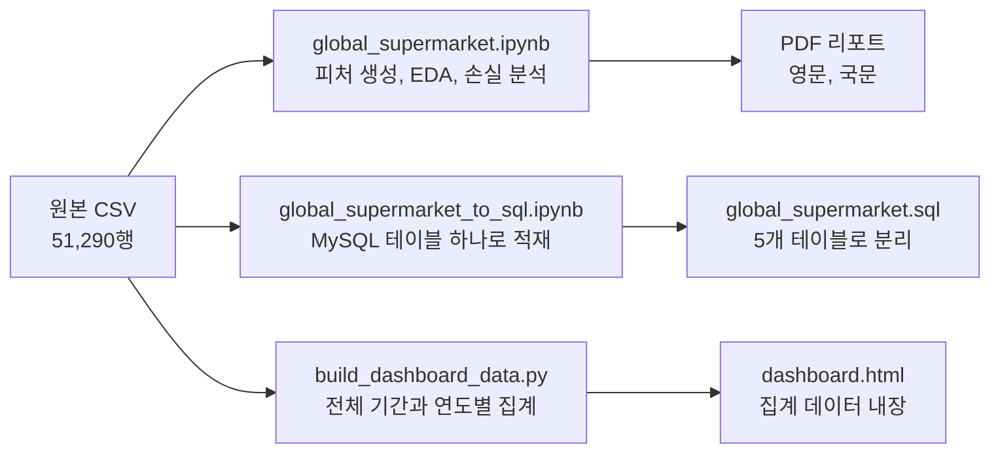
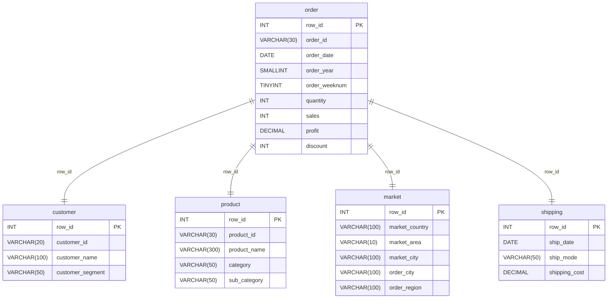

# Global Supermarket Analysis

[English](./README.md)

## GOAL

글로벌 슈퍼마켓의 2019–2022년 주문 데이터를 분석해 손실이 생기는 원인을 찾고, 손실을 줄일 가격 정책을 제안하는 프로젝트다.

- **Q1.** 고객, 주문, 상품, 시장, 배송 데이터에는 각각 어떤 특징이 있는가?
- **Q2.** 손실은 어떤 거래에서 생기고, 이를 줄이려면 어떤 결정을 내려야 하는가?

## Architecture

원본 CSV 하나로 분석 리포트, MySQL 테이블, 대시보드를 각각 만든다.



| 구성 | 역할 | 사용 기술 |
|---|---|---|
| 분석 노트북 | 피처 생성, EDA, 손실 분석, 할인 분석 | Pandas, NumPy, SciPy, Matplotlib, Seaborn |
| SQL | CSV를 MySQL에 넣고 5개 테이블로 나눈다 | MySQL, PyMySQL |
| 대시보드 빌드 | CSV를 집계해 HTML에 넣고 합계를 검증한다 | Python 표준 라이브러리 |
| 대시보드 | 브라우저에서 결과를 살펴본다 | JavaScript, SVG |

MySQL에는 원본을 `row_id` 기준으로 다섯 테이블에 나눠 저장했다.



## Data

원본은 저장소 루트의 `datafile/[DArt-B 5기] Global_Supermarket.csv`다.

- 51,290행, 24열이며 결측값과 중복 행은 없다.
- 2019-01-01부터 2022-12-31까지의 주문으로, 고유 주문 25,035건과 고객 4,873명을 포함한다.
- 7개 시장(APAC, EU, US, LATAM, Africa, EMEA, Canada), 147개국, 서브카테고리 17개에 걸쳐 있다.
- 한 행은 주문 한 건이 아니라 주문에 담긴 상품 한 줄이다.

### Derived Features

| 피처 | 계산 방법 | 쓰임 |
|---|---|---|
| `pre_sales` | `sales / (1 − discount)` | 할인 전 매출 |
| `uni_cost` | `pre_sales / quantity` | 할인 전 개당 판매가(이름과 달리 원가가 아니다) |
| `eta` | `ship_date − order_date` | 주문 후 출고까지 걸린 일수 |

## Method

데이터 전체를 훑어본 뒤 손실이 생기는 곳을 좁혀 가는 순서로 분석했다.

1. EDA: 고객, 주문, 상품, 시장, 배송을 차례로 살펴봤다.
2. 상관 분석: 할인율, 매출, 이익 같은 연속형 변수의 관계를 확인했다.
3. 손실 분석: 서브카테고리, 제조사, 시장, 도시별로 손익을 나눠 봤다.
4. 할인 분석: 할인 구간별 손익을 시장과 서브카테고리에 따라 비교했다.

고할인은 할인율이 40%를 넘는 경우(`discount > 0.4`)로 정의했다. 제조사는 상품명의 첫 단어로 추정했다.

## Results

| 지표 | 값 |
|---|---|
| 총 매출 / 총 이익 | $12.64M / $1.47M (이익률 11.6%) |
| 할인율과 이익의 상관계수 | −0.316 |
| 할인율 40% 초과 거래 | 전체의 13.6% |
| 그 거래가 차지하는 손실 비중 | 전체 손실의 68.2% |

### Key Findings

1. **손실은 고할인 거래에 몰려 있다.** 할인율 40%를 넘는 거래는 전체의 13.6%뿐이지만 전체 손실의 68.2%가 여기서 나온다. 이 거래들이 낸 이익은 전체 이익의 약 0.02%다.
2. **적자를 내는 서브카테고리는 Tables뿐이다.** 순손실은 약 −$64K이고, 제조사별로는 Bevis, Barricks, Lesro의 손실이 가장 컸다.
3. **지역마다 손익 구조가 다르다.** 순이익은 APAC, EU, US, LATAM 순으로 크다. APAC, US, LATAM에서 Tables는 매출의 6–9%지만 손실의 18–21%를 차지하고, EU 손실은 75.6%가 할인율 40–60% 구간에서 나온다.
4. **거래는 늘고 있고 계절성이 뚜렷하다.** 거래는 2019년 8,998건에서 2022년 17,531건으로 약 95% 늘었고, 9월, 11월, 12월에 가장 많다.

### Recommendations

| # | 제언 | 근거 |
|---|---|---|
| 1 | Phones와 Bookcases의 할인율을 40% 이하로 묶는다 | 40%를 넘는 할인이 손실의 68.2%를 만든다 |
| 2 | EU의 고할인 상품 할인율을 평균 20%p 낮춘다 | EU 손실의 75.6%가 40–60% 할인 구간에서 나온다 |
| 3 | Bevis, Barricks, Lesro의 Tables 상품을 줄이거나 단종한다 | 유일한 적자 서브카테고리의 손실 상위 제조사다 |
| 4 | Istanbul, Lagos, Texas의 고할인을 줄인다 | 손실이 가장 큰 세 도시다 |

## Usage

명령은 `projects/Global_Supermarket_Analysis`에서 실행한다.

### Environment

```bash
pip install -r requirements.txt
```

Python 3.10과 3.11에서 실행했다.

### Dashboard

`dashboard.html`은 집계 데이터가 들어 있는 파일이라 서버나 인터넷 연결 없이 브라우저에서 바로 열린다. 연도 필터, 차트와 표 전환, 월별 CSV 내보내기를 지원한다.

```bash
xdg-open dashboard.html                            # 대시보드 열기 (macOS는 open)
python3 dashboard_build/build_dashboard_data.py    # 원본 CSV가 바뀌었을 때 다시 집계
python3 -m unittest discover -s dashboard_build    # 집계 결과와 원본 CSV 대조
```

지표 정의는 [dashboard_build/README.md](./dashboard_build/README.md)에 있다.

### Notebooks

```bash
jupyter notebook global_supermarket.ipynb
```

- 분석 노트북은 GitHub에 올라간 CSV를 URL로 읽으므로 인터넷 연결이 필요하다.
- `global_supermarket_to_sql.ipynb`를 실행하려면 `.env.example`을 `.env`로 복사해 MySQL 접속 정보를 채운다. 적재가 끝나면 [global_supermarket.sql](../../SQL/global_supermarket/global_supermarket.sql)로 테이블을 나눈다.

## Repository Structure

```
Global_Supermarket_Analysis/
├── global_supermarket.ipynb              # 메인 분석
├── gl_supermarkt_recsys.ipynb            # 협업 필터링 추천 실험
├── global_supermarket_to_sql.ipynb       # CSV를 MySQL에 적재
├── dashboard.html                        # 인터랙티브 대시보드
├── dashboard_build/                      # 대시보드 집계 스크립트와 테스트
├── Global_Supermarket_Analysis.pdf       # 최종 리포트 (영문)
├── Global_Supermarket_Analysis_korean.pdf# 최종 리포트 (국문)
├── Global_Supermarket_Analysis_db_schema.png  # Workbench ERD 이미지
├── requirements.txt
└── .env.example                          # MySQL 접속 정보 템플릿

../../SQL/global_supermarket/
├── global_supermarket.sql                # 5개 테이블 생성과 데이터 분리
└── global_supermarket_ERD.mwb            # MySQL Workbench ERD
```
