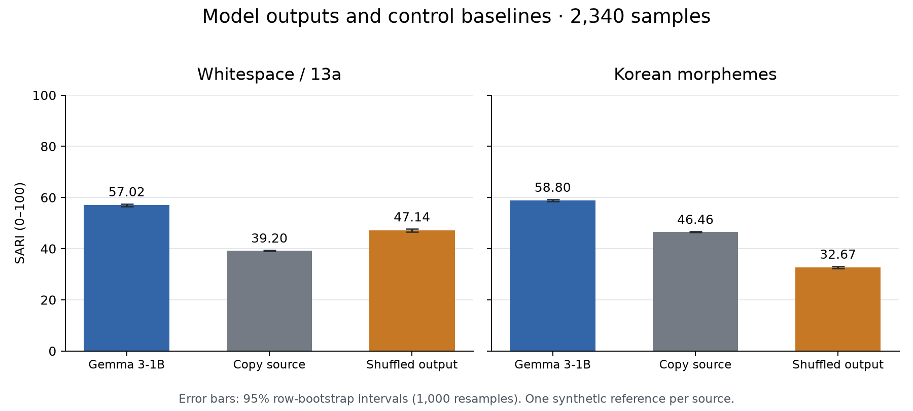

# News Simplification Re-evaluation

**로컬 자동 지표 평가 완료. 외부 LLM 채점 포함 여부는 마지막 LLM Judge 절을 참고한다.**

`result.csv`의 test 문장 2,340개에 대해 Gemma 3-1B 파인튜닝 모델의 출력을 다시 평가한 보고서다. 기존 지표를 재현하고, 한국어에 맞는 지표와 기준선(원문 복사, 출력 섞기)을 함께 계산했다. 이 파일의 표와 수치는 평가 파이프라인이 자동으로 생성한다.
추가 추론이나 재학습 없이 저장된 출력만 평가했으며, `agent/`의 LangGraph 에이전트 성능은 이 결과의 범위에 포함되지 않는다.
평가일: 2026-11-03 (KST). 저장된 test 출력에 대한 평가이며 현재 시점의 뉴스나 새 모델 출력은 포함하지 않는다.

## Summary

- 기존 방식의 SARI는 57.02이며, 원문을 그대로 복사해도 39.20, 다른 문장의 출력과 무작위로 짝지어도 47.14가 나온다. 무작위 대비 실제 차이는 9.9점이다.
- 영어용 가독성 지표 FKGL은 한국어 읽기 학년으로 해석할 수 없다. 본 데이터의 회귀식은 `FKGL ≈ 0.388 × 문장당 어절 수 -3.74`(상관 0.994)로, 주로 문장 길이를 반영한다.
- NLI 자동 판별에서 모델 출력의 모든 문장이 원문으로 뒷받침된다고 분류된 비율은 51.4%, 모순 문장이 있다고 분류된 비율은 5.1%다 (합성 참조문은 각각 40.1%, 3.2%). 실제 오류율을 측정한 수치는 아니다.
- 숫자가 있는 문장 1,526개 중 원문의 숫자를 모두 지킨 비율은 71.2%다(합성 참조문 76.3%). 숫자 값의 집합을 비교한 규칙 지표다.
- 해요체로 끝나는 문장 비율은 원문 0.0%, 모델 73.5%, 합성 참조문 74.3%다. 드문 명사 비율은 원문 7.3%, 모델 4.1%, 합성 참조문 3.1%다.

## How to Reproduce

`projects/NLP_Newspaper_CUAI`에서 실행한다. CPU를 사용하며 실행 시간은 장비와 문장 길이에 따라 달라진다. 중간 결과와 입력·패키지 정보는 `--work-dir`에 보존된다.

```bash
python3.12 -m venv .venv-eval
source .venv-eval/bin/activate
pip install torch --index-url https://download.pytorch.org/whl/cpu
pip install -r evaluation/requirements-eval.txt
python -m evaluation --work-dir evaluation/runs/full --offline --threads 8
```

LLM judge는 외부 API를 호출하므로 `--judge-n`을 줄 때만 실행한다. `OPENROUTER_API_KEY` 또는 `OPENAI_API_KEY`가 필요하다.

## Setup Notes

실험 설정은 `Final_NLP_Newspaper.ipynb`, 참조문 생성 방식은 프로젝트 README의 설명을 기준으로 정리했다.
기본 입력 자료: [원문·참조문·모델 출력 CSV](../result.csv), [원래 실험 노트북](../Final_NLP_Newspaper.ipynb), [프로젝트 설명](../README_KOR.md). 실행·중간 결과 파일은 [재현 안내](README.md)를 참고한다.

- `simplified_human`이라는 열 이름과 달리, README는 ChatGPT API로 생성한 합성 병렬 데이터라고 설명한다. 개별 행의 생성 로그나 사람 검수 여부는 확인할 수 없어 합성 참조문으로 표기한다.
- 학습 프롬프트("초등학생이 이해하기 쉽게 간단하게 바꿔줘")와 추론 프롬프트("청소년이 이해할 수 있도록 변환…중요한 정보는 유지")가 다르다.
- 출력은 `temperature=0.6` 샘플링으로 한 번 생성했고, `max_new_tokens=250`으로 길이를 제한했다.
- 학습·검증 데이터는 저장소에 없어서 test와의 중복 여부는 확인할 수 없다.
- 동일한 프롬프트로 생성한 미세조정 전 기본 모델의 출력이 없어, 미세조정 자체의 개선 효과는 분리해 평가하지 못한다.
- 평가 단위는 CSV의 한 행이다. 원문이 중복된 추가 행은 4개이며, 원래 평가와 비교하기 위해 제거하지 않았다. bootstrap은 행 단위 1,000회 재표집의 95% 구간으로, 실제 독자 평가나 모델·프롬프트 변화의 불확실성을 포함하지 않는다.
- 해요체·드문 명사·끝맺음·숫자 검사는 해석 보조용 휴리스틱이다. 실제 읽기 난이도나 사실 오류를 확정하지 않는다.

## Original Metrics Check

README에 보고된 수치를 노트북과 같은 방식으로 다시 계산했다.

| Metric | Reported | Reproduced | Note |
|---|---:|---:|---|
| ROUGE-1 / 2 / L (F1) | 0.363 / 0.162 / 0.355 | 0.363 / 0.162 / 0.355 | 합성 참조문 기준, 어절 단위 |
| BLEU-1 | 0.338 | 0.338 | 노트북은 참조 문장이 아니라 원문과 비교했다. 참조 문장 기준은 0.387 |
| SARI | 57.02 | 57.02 | 원문 복사 39.20, 출력 섞기 47.14 |
| FKGL (model / reference) | 1.28 / 1.34 | 1.28 / 1.34 | 본 데이터의 회귀식은 `0.388 × 문장당 어절 수 -3.74` |

README의 "SARI 40 이상이면 우수"라는 기준은 원문 복사와 무작위 출력도 넘거나 비슷한 값이라 성능 근거가 되지 않는다. 또한 `agent/evaluation.py`가 쓰는 `rouge_score`의 기본 토크나이저는 한글을 제거하므로 한국어 문장의 ROUGE-L 평가에 부적합하다([Google Research 토크나이저 구현](https://github.com/google-research/google-research/blob/master/rouge/tokenize.py)). 이 보고서는 해당 토크나이저를 사용하지 않는다.

## Reference-Based Metrics

합성 참조문과 얼마나 비슷한지 본다. 참조문이 하나뿐이므로 높은 점수만으로 정확성이나 대상 독자의 이해도를 보장하지 않는다. 괄호는 행 단위 bootstrap 95% 구간이다. `morph`는 Kiwi 형태소 단위다. SARI는 추가·삭제·유지 연산을 비교하는 지표이며([Xu et al., 2016](https://aclanthology.org/Q16-1029/)), 이 실행은 원 노트북의 Hugging Face 구현과 같은 0/0=1 규칙과 13a 정규화를 사용한다.



| Metric | Model (Gemma 3-1B) | Copy source | Shuffled model |
|---|---|---|---|
| SARI (어절, 기존 방식) | 57.02 [56.54, 57.47] | 39.20 [39.03, 39.38] | 47.14 [46.64, 47.65] |
| SARI (형태소) | 58.80 [58.39, 59.22] | 46.46 [46.26, 46.65] | 32.67 [32.27, 33.06] |
| 　SARI keep | 61.39 [60.59, 62.22] | 39.39 [38.78, 39.98] | 19.48 [18.73, 20.20] |
| 　SARI delete | 87.43 [87.01, 87.84] | 100.00 [100.00, 100.00] | 73.05 [72.57, 73.55] |
| 　SARI add | 27.59 [27.10, 28.07] | 0.00 [0.00, 0.00] | 5.48 [5.37, 5.61] |
| BLEU (형태소, 문장 평균) | 28.88 [28.33, 29.44] | 16.15 [15.68, 16.66] | 2.45 [2.37, 2.53] |
| chrF++ | 34.11 [33.61, 34.60] | 22.62 [22.20, 23.03] | 5.51 [5.41, 5.61] |
| ROUGE-L (형태소) | 0.530 [0.525, 0.535] | 0.425 [0.419, 0.430] | 0.150 [0.148, 0.152] |
| BERTScore F1 (mBERT) | 0.841 [0.839, 0.843] | 0.789 [0.787, 0.791] | 0.659 [0.658, 0.660] |
| SBERT cosine | 0.857 [0.854, 0.859] | 0.795 [0.792, 0.799] | 0.258 [0.253, 0.263] |

형태소 SARI의 모델−원문 복사 차이는 12.34 [11.90, 12.78]점이다(대응 행 bootstrap 95% 구간). 무작위 기준선은 seed 0의 한 번의 출력 섞기이며, 구간은 섞기 자체의 변동성을 포함하지 않는다.

Corpus BLEU(형태소)는 model 30.79, copy 18.15, shuffled 2.80다. Corpus chrF++는 model 34.07, copy 23.77, shuffled 5.43다.

## Meaning Preservation

참조 문장 없이 원문과 직접 비교한다. SBERT는 한국어 STS로 학습한 문장 유사도 모델(`snunlp/KR-SBERT-V40K-klueNLI-augSTS`)이다. NLI는 KLUE-NLI로 학습한 `Huffon/klue-roberta-base-nli`로, 출력의 각 문장이 원문에서 추론되는지(support)와 원문의 각 문장이 출력에 남아 있는지(coverage)를 본다.
NLI coverage는 각 원문 문장을 전체 출력에서 추론할 수 있다는 entailment 확률을 행별로 평균한 보조 점수다. 실제 보존된 사실의 비율이나 사람이 확인한 재현율을 뜻하지 않는다.
SBERT는 배포된 모델의 기본 설정인 최대 128토큰을 사용하며, BERTScore는 mBERT의 9번째 층과 최대 512토큰을 사용한다. BERTScore는 IDF 가중치와 기준선 재조정을 사용하지 않았다.
SBERT의 128토큰 한도를 넘는 원문은 52건, 모델 출력은 46건, 합성 참조문은 57건이다. 이 문장들의 점수는 뒷부분을 모두 반영하지 못한다.

| Metric | Model (Gemma 3-1B) | Synthetic reference | Copy source | Shuffled model | Model (Gemma 3-1B) − Synthetic reference |
|---|---|---|---|---|---|
| SBERT cosine (원문) | 0.827 [0.823, 0.830] | 0.795 [0.792, 0.799] | 1.000 [1.000, 1.000] | 0.216 [0.211, 0.220] | 0.032 [0.029, 0.035] |
| BERTScore P (출력 → 원문) | 0.813 [0.811, 0.815] | 0.777 [0.775, 0.779] | 1.000 [1.000, 1.000] | 0.635 [0.633, 0.636] | 0.036 [0.034, 0.038] |
| BERTScore R (원문 → 출력) | 0.824 [0.822, 0.826] | 0.802 [0.800, 0.803] | 1.000 [1.000, 1.000] | 0.637 [0.635, 0.638] | 0.023 [0.021, 0.025] |
| NLI: 모든 문장이 원문으로 뒷받침됨 | 51.4% [49.4, 53.2] | 40.1% [38.2, 42.1] | 81.8% [80.3, 83.4] | — | 11.3 pp [9.3, 13.5] |
| NLI: 원문과 모순되는 문장 있음 | 5.1% [4.2, 5.9] | 3.2% [2.4, 3.9] | 1.9% [1.4, 2.5] | — | 1.9 pp [0.9, 2.9] |
| NLI coverage (원문 문장이 남은 정도) | 0.376 [0.359, 0.394] | 0.348 [0.331, 0.366] | 0.894 [0.885, 0.903] | — | 0.028 [0.010, 0.047] |

NLI는 모델의 분류 결과이며 사실 검증의 정답이 아니다. 원문 복사 기준선도 1.9%에서 모순으로 분류된다. 임계값은 entailment/contradiction 확률 0.5이며 별도 한국어 쉬운 글 검증셋으로 보정하지 않았다. 이 체크포인트는 위치 임베딩 512개와 패딩 위치 오프셋 때문에 실제 입력 한도가 510토큰이며, 긴 입력은 이 한도에서 잘린다. 숫자는 아래에서 규칙으로 따로 확인한다.
실제 한도를 넘는 NLI 입력은 모델 근거 확인 6쌍, 참조문 근거 확인 9쌍, 원문 복사 근거 확인·정보 보존 확인 각각 12쌍이다. 모델·참조문의 정보 보존 확인에서는 한도를 넘는 입력이 없었다.

## Numbers and Names

원문의 숫자를 "100만원 = 100만 원", "2000억 = 2천억", "세 곳 = 3곳"처럼 값으로 바꿔 비교했다. 고유명사는 Kiwi의 NNP 태그로 뽑았다.
숫자는 중복 횟수·단위·주체를 구분하지 않는 값의 집합이므로 숫자를 엉뚱한 대상에 붙인 오류는 놓칠 수 있다. 복합 한글 수사나 범위 표현도 완전히 처리하지 않으며, 법 조항의 '제6조'에서 '조'를 큰 수 단위로 해석하는 등 문맥을 혼동할 수 있다. 재현율과 '모두 지킴'의 분모는 원문에 검출된 숫자가 있는 행이며, 새 숫자 등장 비율의 분모는 전체 행이다. 고유명사 재현율은 검출된 고유명사가 있는 행을 사용한다.

| Metric | Model (Gemma 3-1B) | Synthetic reference | Model (Gemma 3-1B) − Synthetic reference |
|---|---|---|---|
| 원문 숫자 재현율 | 87.5% [86.1, 88.7] | 90.1% [88.9, 91.1] | -2.6 pp [-4.0, -1.2] |
| 원문 숫자를 모두 지킴 | 71.2% [68.9, 73.5] | 76.3% [74.4, 78.3] | -5.1 pp [-7.8, -2.7] |
| 원문에 없는 숫자 등장 | 5.2% [4.3, 6.0] | 7.6% [6.6, 8.7] | -2.4 pp [-3.5, -1.3] |
| 원문 고유명사 재현율 | 91.6% [90.5, 92.7] | 90.5% [89.3, 91.8] | 1.1 pp [-0.1, 2.2] |

숫자가 있는 원문은 1,526개, 고유명사가 있는 원문은 1,513개다.

## Simplicity and Style

FKGL 대신 한국어에서 해석할 수 있는 지표를 썼다. 드문 명사는 `wordfreq` 한국어 빈도 목록에 없거나 Zipf 3.0 미만인 일반명사(NNG)다. 말투는 문장의 종결어미로 나눴다.

| Metric | Model (Gemma 3-1B) | Synthetic reference | Copy source | Model (Gemma 3-1B) − Synthetic reference |
|---|---|---|---|---|
| 글자 수 | 115.3 [112.4, 118.3] | 130.8 [127.8, 134.1] | 107.0 [104.1, 109.9] | -15.5 [-16.8, -14.3] |
| 문장 수 | 2.04 [1.98, 2.10] | 2.30 [2.24, 2.36] | 1.57 [1.52, 1.62] | -0.26 [-0.29, -0.22] |
| 문장당 어절 수 | 13.89 [13.66, 14.12] | 14.39 [14.14, 14.65] | 15.91 [15.59, 16.22] | -0.50 [-0.73, -0.28] |
| 문장당 형태소 수 | 32.3 [31.7, 32.9] | 33.3 [32.7, 33.9] | 36.8 [36.1, 37.5] | -1.0 [-1.5, -0.5] |
| 드문 명사 비율 | 4.1% [3.8, 4.4] | 3.1% [2.8, 3.3] | 7.3% [6.9, 7.7] | 1.1 pp [0.8, 1.3] |
| 해요체 문장 | 73.5% [71.7, 75.2] | 74.3% [72.5, 76.1] | 0.0% [0.0, 0.1] | -0.8 pp [-2.7, 1.3] |
| 해라체(-다) 문장 | 2.5% [1.9, 3.1] | 1.1% [0.7, 1.5] | 86.6% [85.2, 87.9] | 1.4 pp [0.8, 2.1] |
| 반말 문장 | 2.6% [2.0, 3.2] | 5.1% [4.2, 5.9] | 0.9% [0.6, 1.3] | -2.5 pp [-3.5, -1.5] |
| 종결어미 없는 문장 | 1.5% [1.1, 2.0] | 0.6% [0.4, 0.9] | 12.4% [11.1, 13.7] | 0.9 pp [0.4, 1.4] |

Copy source 열은 원문 자체의 값이다. 길이·말투 비율은 각 행의 값을 평균한 수치이며, 전체 문장을 합친 가중 비율과는 다르다. 친근한 말투로의 변경만으로 이해도가 높아졌다고 볼 수 없다. 비율의 차이 열은 퍼센트포인트(pp) 단위다.

## Output Defects

| Metric | Model (Gemma 3-1B) | Synthetic reference | Model (Gemma 3-1B) − Synthetic reference |
|---|---|---|---|
| 원문과 완전히 같음 | 0.2% [0.0, 0.4] | 0.0% [0.0, 0.0] | 0.2 pp [0.0, 0.4] |
| 원문과 글자 유사도 | 0.590 [0.584, 0.596] | 0.506 [0.501, 0.511] | 0.084 [0.079, 0.090] |
| 끝맺지 않은 출력 | 1.6% [1.1, 2.1] | 0.3% [0.1, 0.6] | 1.2 pp [0.7, 1.8] |
| 같은 어절 3-gram 3회 이상 반복 | 0.4% [0.2, 0.6] | 0.3% [0.1, 0.6] | 0.0 pp [-0.2, 0.3] |
| 한자 글자 수 | 0.001 [0.000, 0.003] | 0.000 [0.000, 0.001] | 0.001 [0.000, 0.003] |

## By Source Length

원문 글자 수로 세 구간을 나눴다(short ≤ 70, medium ≤ 118, long > 118). 모델 출력만 표시한다.

| Metric | short | medium | long |
|---|---|---|---|
| SARI (형태소) | 60.39 [59.50, 61.32] | 58.94 [58.25, 59.57] | 57.04 [56.53, 57.57] |
| SBERT cosine (원문) | 0.792 [0.785, 0.800] | 0.835 [0.830, 0.841] | 0.853 [0.849, 0.857] |
| NLI 모순 있음 | 4.7% [3.2, 6.1] | 5.3% [3.9, 7.0] | 5.3% [3.7, 7.0] |
| 숫자 모두 지킴 | 84.2% [80.5, 87.7] | 72.3% [68.4, 76.0] | 61.7% [57.9, 65.3] |
| NLI coverage | 0.495 [0.462, 0.527] | 0.445 [0.416, 0.477] | 0.186 [0.166, 0.205] |
| 끝맺지 않은 출력 | 2.5% [1.5, 3.7] | 0.0% [0.0, 0.0] | 2.2% [1.2, 3.2] |

## Examples

자동 지표로 찾은 문제 후보 사례다. 원문, 모델 출력, 합성 참조문 순서다. 전체 오류율을 추정하기 위한 대표 표본은 아니다.

**원문과 모순으로 판별된 후보 (NLI)** · #2008

- 원문: 신청 대상은 수도권에 사는 무주택 세대구성원으로 주택청약종합저축 또는 청약저축 가입자여야 한다.
- 모델: 신청할 수 있는 사람은 수도권에 사는 집이 없는 가족 구성원이에요. 이 가족에 속하는 사람들은 주택청약종합저축이나 청약저축에 가입해야 해요.
- 합성 참조문: 신청할 수 있는 사람은 서울, 인천, 경기 지역에 사는 집이 없는 가족의 구성원이어야 해. 그리고 주택청약종합저축이나 청약저축에 가입한 사람이어야 해.

**원문과 모순으로 판별된 후보 (NLI)** · #1285

- 원문: 사업 대상은 시설보수비용 지원의 경우 사용승인일로부터 10년이 경과한 5세대 이상의 공동주택이다.
- 모델: 사업을 받을 수 있는 집은 시설 보수비용을 도와주는 경우, 사용 승인일로부터 10년이 지나지 않은 5세대 이상의 아파트이다.
- 합성 참조문: 지금까지 10년이 지난 5층 이상 아파트는 시설 수리비를 받을 수 있어요.

**원문과 모순으로 판별된 후보 (NLI)** · #167

- 원문: 저소득 지역가입자를 대상으로 하는 최저보험료는 대상을 확대하면서 보험료를 늘리는 방식으로 바뀌었다.
- 모델: 저소득 지역가입자를 위해 보험료를 낮추는 방법이 바뀌었어요. 이제 더 많은 사람들에게 더 적은 돈을 내야 한다는 규칙이 생겼어요.
- 합성 참조문: 저소득 지역가입자를 위한 최저보험료가 바뀌었어요. 이제 더 많은 사람들이 이 혜택을 받을 수 있게 되었고, 그 대신 보험료가 조금 더 올라갔어요.

**숫자 누락·변경** · #5

- 원문: 1일 부천시에 따르면 시는 중소기업 지원책의 하나로 성장 잠재력을 가진 작지만 강한 유망 중소기업을 발굴하고자 강소기업을 선정한다.
- 모델: 부천시가 오늘 발표한 내용에 따르면, 중소기업을 키우고 성장할 가능성이 있는 작은 기업들을 찾아서 특별히 도와줄 거예요.
- 합성 참조문: 부천시에서는 중소기업을 도와주기 위해, 성장 가능성이 큰 작지만 힘이 있는 좋은 중소기업을 찾고 있어요. 그래서 특별한 기업을 뽑고 있어요.

**숫자 누락·변경** · #24

- 원문: 국가산업단지는 국가기간산업의 발전, 첨단과학기술산업 등을 육성하거나 개발 촉진이 필요한 낙후지역을 산업단지로 개발하기 위해 산업입지 및 개발에 관한 법률 제6조에 따라 지정한다. 둘 이상의 특별시·광역시·특별자치시 또는 도에 걸쳐 있는 지역도 국가산업단지 대상에 포함된다.
- 모델: 국가산업단지는 나라에서 중요한 산업을 발전시키고, 새로운 기술을 개발하는 지역을 도와주기 위해 만들어집니다. 이 지역이 나이가 많거나 산업이 부족한 곳을 산업단지로 개발하기 위해 지정됩니다. 두 개 이상의 특별한 지역이나 도시가 있는 경우도 국가산업단지에 포함됩니다.
- 합성 참조문: 국가산업단지는 나라의 중요한 산업을 발전시키고, 최신 과학 기술이 필요한 지역을 발전시키기 위해 만들어진 특별한 지역이에요. 이 지역은 법에 따라 정해지며, 여러 도시나 도가 함께 있는 곳도 포함될 수 있어요.

**숫자 누락·변경** · #25

- 원문: 또 마을회관에서 만난 한 주민이 “우정마을에 평생을 살아오면서 사정상 잠시 두 달간 주소를 옮겼는데 주거 이전비를 못 받게 됐다” 며 하소연하자 “구제할 방법이 있는지 알아보겠다”고 했다.
- 모델: 또 마을회관에서 만난 한 주민이 “우정마을에 평생 살면서 힘든 상황 때문에 한 달 동안 집을 옮겼는데, 이사 비용을 못 받을 것 같아서 걱정한다”며 “이런 방법이 있는지 알아보겠다”고 말했어요.
- 합성 참조문: 마을회관에서 한 주민이 “우정마을에서 평생 살았는데, 어떤 이유로 두 달 동안 주소를 옮겼더니 집을 옮긴 돈을 받을 수 없게 됐다”고 이야기했어요. 그러자 누군가 “도와줄 방법이 있는지 알아볼게요”라고 대답했어요.

**끝맺지 않은 출력** · #65

- 원문: 농림축산식품부는 이재민의 생계 안정을 위해 1인당 월 10㎏의 정부 양곡을 무상으로 지원한다. 여기에 이재민에게 건강보험료를 3개월분(인적·물적 동시 피해 시 6개월분) 최대 50%를 경감해주고, 국민연금과 관련해서는 납부 예외 기간 1년을 부여하기로 했다. 주거 상실자에 대해서는 병원·약국 이용 시 본인부담금을 면제하거나 인하해준다. 멸실(철거) 건축물에 대해서는 전기요금(최대 200만원…
- 모델: 농림축산식품부는 이재민의 생활을 안정시키기 위해 한 사람당 매달 10킬로그램의 정부 양곡을 무료로 지원합니다. 이 양곡은 주로 곡물로 구성돼서, 사람들이 먹을 수 있는 음식을 도와줍니다. 이 양곡을 주는 데 필요한 건강보험료를 3개월 동안 (인적·물적 피해 시는 6개월) 최대 50% 줄여줍니다. 국민연금에 대해서는 납부 예외 기간을 1년으로 늘리기로 했습니다. 주거를 잃은 사람들에게는 병원…
- 합성 참조문: 농림축산식품부는 재난으로 피해를 입은 사람들을 도와주기 위해 몇 가지 지원을 합니다. 먼저, 피해를 입은 사람 한 명당 매달 10킬로그램의 쌀을 무료로 줍니다. 그리고 건강보험료는 3개월 동안 최대 50% 줄여주고, 만약 더 큰 피해를 입었다면 6개월 동안 줄여줍니다. 국민연금도 1년 동안 돈을 내지 않아도 되게 해줍니다. 집을 잃은 사람들은 병원이나 약국에 갈 때 내야 하는 돈을 면제해주…

**끝맺지 않은 출력** · #100

- 원문: 아파트 매매가 또 최고치 찍어
- 모델: 아파트 가격이 다시 최고로 올라서
- 합성 참조문: 아파트 가격이 다시 가장 높아졌어요.

## LLM Judge

이번 실행에는 외부 LLM 채점이 포함되지 않았다. 로컬 지표만으로 사람의 의미 보존·이해도 평가를 대신할 수 없다.

<!-- manual: 이 줄 아래는 직접 작성한 해석이며, 파이프라인을 다시 실행해도 유지된다. -->

## Interpretation

기존 수치는 재현되지만, SARI 40점과 영어용 FKGL을 근거로 한국어 초등학생 수준의 품질이 입증됐다고 결론 내릴 수 없다. 특히 원문과 관계없는 무작위 출력도 기존 SARI에서 47.14를 받는다. 한국어 형태소 단위에서는 모델 58.80, 원문 복사 46.46, 무작위 출력 32.67로 모델이 기준선보다 높다. 이는 이 합성 참조문과의 어휘 편집 일치도를 뒷받침하는 결과다.

모델의 평균 글자 수는 원문보다 늘어나면서 문장당 어절 수는 줄었다. 문장을 나누거나 설명을 덧붙인 영향일 수 있지만, 길이 변화와 친근한 말투만으로 실제 독자의 이해도가 높아졌다고 볼 수는 없다. 드문 명사 지표 역시 어휘 빈도를 근거로 한 보조 지표다.

별도로 살펴본 진단 사례에서는 의미 보존 문제가 확인됐다. 이 사례들은 오류를 찾기 위해 선택한 것으로 전체 오류율을 나타내지는 않는다.

- **행 0:** 원문의 “구역 3~5곳이 추가 접수될 전망”에서 출력은 날짜 29일만 유지하고 3~5곳이라는 수량을 생략했다.
- **행 1:** 원문은 기존 4개 생활권 중 오포와 경안을 합쳐 3개로 재편한다는 뜻이다. 출력은 “4개 지역을 하나로 합쳐서 3개로” 바꿔 관계를 왜곡했다. 4와 3이라는 숫자 값 자체는 남아 있어 숫자집합 검사만으로는 이 문제를 찾을 수 없다.
- **행 25:** 원문의 “두 달간 주소를 옮겼다”가 출력에서 “한 달 동안 집을 옮겼다”로 바뀌었고, 인용문의 화자 관계도 달라졌다.
- **행 1285:** 원문의 “사용승인일로부터 10년이 경과한”이라는 조건이 출력에서 “10년이 지나지 않은”으로 뒤집혔다. 10년·5세대라는 수치는 유지돼도 지원 자격의 의미는 달라졌다. 같은 행의 합성 참조문도 “5세대”를 “5층”으로 바꿨으므로, 참조문을 사실 검증의 정답으로 가정할 수 없다.

따라서 이 평가가 지지하는 결론은 “저장된 모델 출력은 원문 복사보다 합성 참조문에 가까운 편집을 수행하지만, 의미와 숫자 보존에 개별 오류가 남아 있다”이다. 대상 연령에 맞는 이해도나 배포 적합성을 확정하려면 원문을 기준으로 한 독립적인 사람 검수와 실제 독자 평가가 필요하다. NLI 분류와 외부 LLM 채점은 그러한 평가를 대신하는 정답이 아니다.
