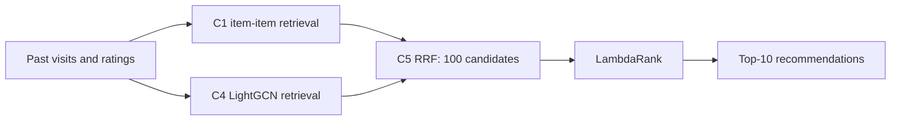

# Rating Recommender System

[Korean](./README_KOR.md)

This research project compares methods for recommending restaurants that users are likely to enjoy, using DiningCode visits, ratings, and review text.

Updated: **2026-10-13 KST**

The current baseline uses visit and rating history only. Several review-based methods have been evaluated, but none has shown a stable improvement over the behavioral baseline.

## Documentation

Start here for the task and system overview, then use the results index to choose a report. Each document has a distinct responsibility.

| Document | Purpose |
|---|---|
| [PLAN.md](./PLAN.md) | Research questions, completed work, and next validation priorities |
| [BASELINE_MODEL.md](./BASELINE_MODEL.md) | Baseline inputs, retrieval, reranking, and evaluation rules |
| [reports/README.md](./reports/README.md) | Find the report explaining a method and its conclusion |
| [SATISFACTION_BASELINE.md](./SATISFACTION_BASELINE.md) | Definitions and examples of user-specific satisfaction labels |
| [artifacts/README.md](./artifacts/README.md) | Retention and restoration of models, caches, source text, and archives |

Most detailed research documents are currently written in Korean.

## Current System

The pipeline separates retrieval from reranking because scoring every restaurant with the full ranking model would be expensive. Behavioral retrievers first produce 100 candidates, and a richer model then orders the Top-10. This separation also makes it possible to distinguish retrieval failures from ordering failures.



| Component | Information and role |
|---|---|
| C1 item-item retrieval | Finds restaurants co-visited with those in the user's history |
| C4 LightGCN retrieval | Uses relationships propagated through the user–restaurant visit graph |
| C5 fusion | Combines C1/C4 ranks with RRF and excludes visited items, retaining up to 100 candidates |
| LambdaRank reranking | Uses 16 behavioral, rating, and region features to order the same candidates |

Review text is not part of the baseline; menu and external attributes remain unevaluated. Current work focuses on finding better candidates from the full catalog. Reranking cannot introduce an item missing from its candidate set, which limits its ability to address retrieval failures.

Two-stage refers to the full retrieval–reranking pipeline. Two-Tower refers to separate user and restaurant encoders. Temporal splitting and sequential recommendation are separate experimental dimensions.

## Data and Evaluation

The temporal split reconstructs what would have been available at recommendation time. Future reviews and ratings never enter historical profiles; observed future visits are used only as evaluation targets.

1. Frozen data

   - Snapshot: `e7896add5b4b5939`
   - First user–restaurant interactions: 88,554
   - Users: 14,008
   - Restaurants: 4,587

2. Temporal split

   - Train: 70,883 interactions through 2025-12-19 (T1)
   - Validation: 8,934 interactions in `(T1, 2026-05-04]` (T2)
   - Test: 8,737 interactions over approximately 145 days after T2
   - Future reviews and ratings are used only as labels, never as model inputs

3. Evaluation population

   - Validation: 1,639 users with history and relevant future outcomes
   - Test: 1,573 users with history and relevant future outcomes
   - Users without prior history are excluded from the current personalized evaluation
   - Relevant restaurants outside the cutoff catalog remain in the recall denominator

4. Primary metrics

   - Candidate retrieval: Recall@100
   - Full pipeline: graded NDCG@10
   - Target: user-specific future satisfaction levels 0/1/2
   - Relevant outcome: an observed future rating of at least 3

## Baseline Results

These are the 2026-10-04 Window/history-aware test results for seed 42. They were produced before the 2026-10-12 bug fixes.

| Stage | Recall@100 | NDCG@10 | Recall@10 |
|---|---:|---:|---:|
| C5 candidate order | 20.1626% | 0.026590 | — |
| Same C5 → LambdaRank | 20.1626% | 0.025467 | 3.6502% |

Recall@100 measures the share of future relevant items retrieved, averaged per user. These results leave substantial room to improve candidate retrieval. Reranking retains the same items, so Recall@100 stays unchanged; NDCG@10 measures its effect on the top positions. This test did not establish a reranking gain.

No review-based method has been adopted, and real-data retraining and evaluation after the October 12 fixes have not been run.

See the [baseline run report](./artifacts/runs/20261004T125314601899Z-e7896add/report.md) and [baseline diagnostics](./reports/baseline.md).

## Experiment History

Experiments are grouped by the question they test rather than by model name alone. Standalone text retrieval, behavior–text fusion, review aggregation, and controlled text-input ablations answer different questions and should not be ranked as one uniform benchmark.

1. Lexical and semantic retrieval

   - DeepCoNN, BM25, Liquid, and frozen E5 mean retrieval
   - Standalone and C5-fusion results were lower or inconclusive

2. Review-aware learned models

   - E5 features for LambdaRank
   - E5 Two-Tower
   - Review Transformer with Top-200 cross-attention
   - No stable incremental gain

3. Behavioral models with text

   - RLMRec/E5 alignment
   - Ten aspect–sentiment channels
   - Fixed text restaurant graph
   - No stable improvement over the behavioral control

4. Multi-review and multi-interest representations

   - Review-level Top-3 matching
   - K1/K3 user interests
   - Learned mean, late, and shuffled-late retrieval
   - Some standalone text signal, but no confirmed complement to C5

5. Controlled comparisons

   - Behavior-only versus behavior+E5 Two-Tower, three seeds and 12 fixed epochs
   - Behavioral graph, text graph, and learned review retrieval, three seeds
   - Most text-effect confidence intervals included zero

6. Data and representation diagnostics

   - Review length, rating distribution, and sparsity
   - LLM aspect and sentiment extraction
   - RQ-VAE review codes and neighbor preservation

See the [experiment timeline](./PLAN.md#실험-이력) and [review embedding report](./reports/review_embeddings.md) for detailed conditions and results.

## Bug Fixes

Six implementation issues were corrected on 2026-10-12.

These changes align implementation with the intended evaluation and input contracts. A bug fix is not itself evidence of better recommendation quality, so prior artifacts remain historical records and performance effects require separate retraining.

1. Indirect-negation scope in opinion extraction
2. Minimum token budget and role-prefix preservation in the E5 formatter
3. Sampling audit when graph and review epoch budgets differ
4. Negation preservation in BM25 POS filtering
5. Inference handling for IDs absent from Two-Tower training
6. Full-truth IDCG and query denominators for LambdaRank early stopping

- Full suite: **512 passed, 1 skipped**
- Existing artifacts and reported metrics remain pre-fix records
- Post-fix real-data performance has not been measured

## Usage

Run commands from `projects/rating_recsys`.

1. Inspect existing input and caches

   ```bash
   .venv/bin/python -m rating_recsys.experiments.review_ltr \
     --snapshot artifacts/snapshots/e7896add5b4b5939.jsonl --dry-run
   ```

   - No model training
   - No missing-embedding inference
   - Checks saved E5 profiles and cache identity

2. Train the baseline

   ```bash
   .venv/bin/python -m rating_recsys.experiments.cli \
     --snapshot artifacts/snapshots/e7896add5b4b5939.jsonl \
     --ranker-training-mode window --satisfaction-mode history-aware \
     --satisfaction-min-history 10 --label window-personal-satisfaction-n10
   ```

3. Run the controlled Two-Tower text comparison

   ```bash
   .venv/bin/python -m rating_recsys.experiments.two_tower_ablation_cli \
     --epochs 12 --seeds 42 43 44 --threads 4
   ```

   - Validation only
   - Keeps behavioral inputs and training fixed
   - Changes only zero versus real E5 inputs

4. Compare text graphs and learned review retrieval

   ```bash
   .venv/bin/python -m rating_recsys.experiments.text_retrieval_comparison_cli \
     --seeds 42 43 44 --graph-epochs 20 --review-epochs 12 --threads 4
   ```

   - Validation only
   - Text graph versus rewired control
   - Mean, late, and shuffled-late review scoring

5. Create the environment

   ```bash
   conda create --prefix ./.venv python=3.10 pip libgomp -y
   conda activate ./.venv
   pip install -e '.[experiment,dev]'
   ```

   - DeepCoNN and PyTorch models: `deepconn`
   - Local E5 inference: `local-embeddings`
   - BM25 and Korean tokenization: `bm25`
   - RQ-VAE: `rqvae`

6. Run tests

   ```bash
   .venv/bin/python -m pytest -q
   .venv/bin/python -m rating_recsys.experiments.compare_cli --help
   ```

## Repository Structure

1. Source and tests

   - `src/rating_recsys/`: data, retrieval, ranking, and evaluation
   - `tests/`: regression and integration tests

2. Documentation

   - `PLAN.md`: research plan and status
   - `BASELINE_MODEL.md`: baseline definition
   - `reports/`: method-level results and interpretation

3. Experiment artifacts

   - `artifacts/snapshots/`: frozen inputs
   - `artifacts/prepared/`: reusable candidates and training rows
   - `artifacts/runs/`, `artifacts/comparisons/`: settings, models, rankings, and metrics
   - `artifacts/local_models/` and E5 SQLite caches: local frozen models and embeddings

4. Collection and ingestion

   - `crawler/`: data collection
   - `migrations/`: database schema
   - `queries/`: validation SQL

Documentation follows [docs_style.md](./docs_style.md). API responses, source text, models, and archives are local artifacts; their retention status is documented in [artifacts/README.md](./artifacts/README.md).
