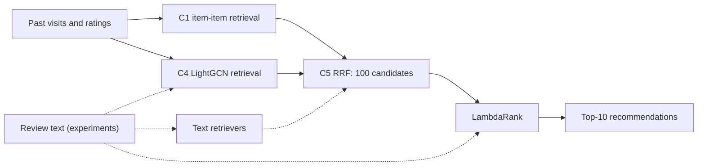

# Rating Recommender System

[Korean](./README_KOR.md)

## GOAL

A project that collects restaurant visits, ratings, and reviews from DiningCode and uses them to develop models that recommend better restaurants to each user.

- **RQ1.** Does adding review text improve recommendations over a model that uses only visits and ratings?
- **RQ2.** How does performance change with the recommendation architecture (two-stage, Two-Tower, graph, multi-vector)?

## Architecture

Recommendation runs in two stages: visit history first retrieves 100 candidates, and LambdaRank then orders the Top-10 within them.



Solid lines show the baseline; dashed lines show where review text was added in experiments.

| Component | Role |
|---|---|
| C1 item-item retrieval | Finds restaurants often co-visited with those the user visited |
| C4 LightGCN retrieval | Finds related restaurants through the user–restaurant visit graph |
| C5 fusion | Merges C1 and C4 ranks with RRF into 100 candidates |
| LambdaRank reranking | Orders the Top-10 using 16 visit, rating, and region features |

## Data

DiningCode reviews are crawled into Supabase PostgreSQL, and experiments use a frozen snapshot (`e7896add5b4b5939`): 88,554 first visits by 14,008 users to 4,587 restaurants. The data is split by time so that no future information enters the inputs.

| Split | Period | Visits |
|---|---|---:|
| Train | Through 2025-12-19 | 70,883 |
| Validation | 2025-12-20 – 2026-05-04 | 8,934 |
| Test | 2026-05-05 – 2026-09-26 | 8,737 |

## Evaluation

Each user with prior history receives a recommendation list, which is scored against the restaurants they actually visited later.

- **Users:** 1,639 in validation and 1,573 in test. New users without prior history are excluded.
- **Labels:** restaurants visited later and rated at least 3. Visits are graded by satisfaction, and the "very satisfied" threshold is adjusted between 3.5 and 4.5 by each user's past average ([definition](./SATISFACTION_BASELINE.md)).
- **Metrics:** Recall@100 for candidate retrieval and graded NDCG@10 for the full pipeline.
- **Comparisons:** settings are chosen on validation, and test is used only for the final check. Review effects are measured by changing only the text in the same model; an improvement whose 95% interval includes zero is not counted.

## Results

### Baseline

Test results for seed 42.

| Stage | Recall@100 | NDCG@10 | Recall@10 |
|---|---:|---:|---:|
| C5 candidate order | 20.1626% | 0.026590 | — |
| Same C5 → LambdaRank | 20.1626% | 0.025467 | 3.6502% |

The baseline places about 20% of each user's future relevant restaurants within its 100 candidates. Reranking with LambdaRank slightly lowered NDCG@10, so no reranking gain was found. See the [baseline report](./reports/baseline.md) for details.

### Review Experiments

Experiments are grouped by where review text was used. The reference is validation C5 Recall@100 of **19.48%**.

| Method | How reviews are used | Evaluation | Representative result | Verdict |
|---|---|---|---|---|
| Lexical retrieval | BM25 | Validation | Alone 4.54%; added to C5 16.69% | Pushed out more hits than it added |
| Frozen embedding retrieval | E5 mean, review-level matching, three interests (K3) | Validation | Alone 4.50% → K3 5.50% | Text alone carries some signal |
| Standalone neural retrieval | Two-Tower, review Transformer | Validation | Two-Tower 9.12% → with E5 9.39%; Transformer 9.67% | Far below C5 |
| Behavioral graph + text | RLMRec, text graph, learned late matching | Validation | RLMRec+C1 19.62%; text graph 18.20%; late 18.45% | No clear gain |
| Reranking features | Six E5 similarity features | Test | NDCG@10 0.025467 → 0.025570 | Gain within the margin of error |
| Compressed representation | RQ-VAE review codes | Representation audit | 144.63× smaller storage | No recommendation gain |

Values are Recall@100 unless noted. Exact values and confidence intervals are in the [review embedding report](./reports/review_embeddings.md).

### Interpretation and Limitations

No review-based method beat C5 consistently, so the baseline uses no review text. It is still too early to conclude that reviews are useless:

- The candidate list is fixed at 100, so every new hit a text retriever finds pushes out an existing one. Adding BM25 brought in 83 relevant pairs but pushed out 241.
- Most runs changed only inputs or architecture; hyperparameters were not searched broadly.
- All numbers were measured before the code fixes of 2026-10-12 and have not been re-evaluated since.

Next validation steps are in [PLAN](./PLAN.md#다음-작업).

## Usage

Run commands from `projects/rating_recsys`. Snapshots, caches, and checkpoints are not in Git; on another machine, restore them first by following [artifacts/README.md](./artifacts/README.md).

### Environment

```bash
conda create --prefix ./.venv python=3.10 pip libgomp -y
conda activate ./.venv
pip install -e '.[experiment,dev]'
pip install -e '.[deepconn,local-embeddings,bm25]' \
  --extra-index-url https://download.pytorch.org/whl/cpu   # for PyTorch models
pytest -q
```

RQ-VAE uses a separate Python 3.12 environment ([RQ-VAE report](./reports/rqvae.md)).

### Running Experiments

```bash
# Retrain the baseline (flags differ from the CLI defaults)
rating-recsys-experiment \
  --snapshot artifacts/snapshots/e7896add5b4b5939.jsonl \
  --ranker-training-mode window --satisfaction-mode history-aware \
  --satisfaction-min-history 10 --label window-personal-satisfaction-n10

# Compare a candidate model with C5 (lightgcn, deepconn, bm25, two_tower)
rating-recsys-compare lightgcn --help

# Validation-only controls: text on/off in the same Two-Tower; text graph and review retrieval
rating-recsys-two-tower-ablation --epochs 12 --seeds 42 43 44 --threads 4
rating-recsys-text-retrieval-comparison \
  --seeds 42 43 44 --graph-epochs 20 --review-epochs 12 --threads 4

# Streamlit dashboard for saved runs
rating-recsys-dashboard
```

### Data Collection and Ingestion

Database tasks need `DATABASE_URL` and `USER_HASH_SALT` in `.env` (see `.env.example`).

```bash
rating-recsys-migrate                              # Apply the database schema
rating-recsys-ingest --dry-run                     # Check V1 CSV ingestion (no database connection)
python -m rating_recsys.ingestion.import_crawler   # Copy the latest crawl CSV and load it
rating-recsys-dataset                              # Audit the database time split
```

`import_crawler` does not accept even `--help`; it starts loading immediately.

<details>
<summary>Run a new crawl</summary>

```bash
pip install -r crawler/requirements.txt
playwright install chromium
python crawler/diningcode_playwright.py --national-regions --max-restaurants 0
```

If the crawl stops, rerun the same command with `--resume`.

</details>

## Repository Structure

```
rating_recsys/
├── src/rating_recsys/   # Data, retrieval, ranking, and evaluation
├── tests/               # Regression and integration tests
├── scripts/             # Audit and verification scripts
├── crawler/             # DiningCode crawler
├── migrations/          # Database schema
├── queries/             # Validation SQL
├── reports/             # Method-level result reports
├── artifacts/           # Snapshots, models, and run outputs (mostly local only)
└── legacy/              # Original V1 crawl CSVs
```

### Documentation

Detailed research documents are written in Korean.

| Document | Contents |
|---|---|
| [PLAN.md](./PLAN.md) | Research questions, experiment history, and next steps |
| [BASELINE_MODEL.md](./BASELINE_MODEL.md) | Baseline inputs, training, and evaluation rules |
| [reports/README.md](./reports/README.md) | Index of method-level reports |
| [SATISFACTION_BASELINE.md](./SATISFACTION_BASELINE.md) | Definition of user-specific satisfaction labels |
| [artifacts/README.md](./artifacts/README.md) | Storage and restoration of models, caches, and source files |
