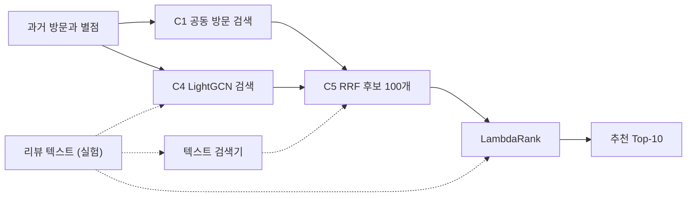

# Rating Recommender System

[English](./README.md)

## GOAL

DiningCode에서 식당 방문 기록, 별점, 리뷰를 수집하고, 이를 활용해 사용자에게 더 나은 식당을 추천할 수 있는 모델을 개발하는 프로젝트다.

- **RQ1.** 리뷰 텍스트를 함께 쓰면 방문 기록과 별점만 쓰는 모델보다 추천이 좋아지는가?
- **RQ2.** 추천 모델의 구조(Two-stage, Two-Tower, 그래프, 다중 벡터)에 따라 성능이 어떻게 달라지는가?

## Architecture

추천은 두 단계로 나눈다. 방문 기록으로 후보 100개를 먼저 고르고, LambdaRank가 그 안에서 Top-10 순서를 정한다.



실선은 기준 모델이고, 점선은 리뷰를 넣어 실험한 위치다.

| 구성 | 역할 |
|---|---|
| C1 공동 방문 검색 | 사용자가 다녀간 식당과 함께 자주 방문된 식당을 찾는다 |
| C4 LightGCN 검색 | 사용자–식당 방문 그래프로 관련 식당을 찾는다 |
| C5 후보 결합 | C1과 C4의 순위를 RRF로 합쳐 후보 100개를 만든다 |
| LambdaRank 재정렬 | 방문, 별점, 지역 등 16개 feature로 Top-10 순서를 정한다 |

## Data

DiningCode 리뷰를 크롤링해 Supabase PostgreSQL에 저장하고, 실험에는 고정한 snapshot(`e7896add5b4b5939`)을 쓴다. 사용자 14,008명, 식당 4,587곳의 첫 방문 기록 88,554건이다. 미래 정보가 입력에 섞이지 않도록 시간 순서로 나눴다.

| 구간 | 기간 | 방문 기록 |
|---|---|---:|
| Train | 2025-12-19까지 | 70,883 |
| Validation | 2025-12-20 ~ 2026-05-04 | 8,934 |
| Test | 2026-05-05 ~ 2026-09-26 | 8,737 |

## Evaluation

과거 이력이 있는 사용자에게 추천 목록을 만들고, 이후 실제로 방문한 식당을 얼마나 맞혔는지 본다.

- **평가 사용자:** validation 1,639명, test 1,573명이다. 과거 이력이 없는 신규 사용자는 제외했다.
- **정답:** 이후 방문해 3점 이상을 준 식당이다. 만족도에 따라 등급을 나누며, "매우 만족" 기준은 사용자의 과거 평균에 따라 3.5~4.5점 사이로 조정한다([정의](./SATISFACTION_BASELINE.md)).
- **지표:** 후보 검색은 Recall@100, 전체 추천은 Graded NDCG@10으로 평가한다.
- **비교 방식:** 설정은 validation으로 고르고 test는 마지막 확인에만 쓴다. 리뷰의 효과는 같은 모델에서 텍스트만 바꿔 비교하고, 95% 구간이 0을 포함하면 개선으로 보지 않는다.

## Results

### Baseline

seed 42의 test 결과다.

| 단계 | Recall@100 | NDCG@10 | Recall@10 |
|---|---:|---:|---:|
| C5 후보 순서 | 20.1626% | 0.026590 | — |
| 같은 C5 → LambdaRank | 20.1626% | 0.025467 | 3.6502% |

기준 모델은 이후 방문한 정답 식당의 약 20%를 후보 100개 안에 담는다. LambdaRank로 순서를 바꾸면 NDCG@10이 오히려 조금 낮아져, 재정렬로 얻은 이득은 확인하지 못했다. 자세한 분석은 [baseline 리포트](./reports/baseline.md)에 있다.

### Review Experiments

리뷰를 어디에 썼는지에 따라 실험을 묶었다. 비교 기준은 validation에서 C5의 Recall@100인 **19.48%**다.

| 방법 | 리뷰를 쓰는 방식 | 평가 조건 | 대표 결과 | 판단 |
|---|---|---|---|---|
| 단어 검색 | BM25 | validation | 단독 4.54%, C5에 추가하면 16.69% | 새로 찾은 정답보다 밀려난 정답이 많음 |
| 고정 임베딩 검색 | E5 평균, 리뷰별 매칭, 취향 3개(K3) | validation | 단독 4.50% → K3 5.50% | 리뷰만으로 찾는 신호는 있음 |
| 별도 신경망 검색 | Two-Tower, 리뷰 Transformer | validation | Two-Tower 9.12% → E5 추가 9.39%, Transformer 9.67% | C5보다 크게 낮음 |
| 행동 그래프 + 텍스트 | RLMRec, 텍스트 그래프, 학습형 late 매칭 | validation | RLMRec+C1 19.62%, 텍스트 그래프 18.20%, late 18.45% | 뚜렷한 개선 없음 |
| 재정렬 feature | E5 유사도 feature 6개 | test | NDCG@10 0.025467 → 0.025570 | 개선 폭이 오차 범위 안 |
| 압축 표현 | RQ-VAE 리뷰 코드 | 표현 검사 | 저장 크기 144.63배 축소 | 추천 성능은 오르지 않음 |

따로 적지 않은 값은 Recall@100이다. 정확한 값과 신뢰구간은 [리뷰 임베딩 리포트](./reports/review_embeddings.md)에 있다.

### Interpretation and Limitations

리뷰를 쓴 방법 중 C5를 꾸준히 이긴 방법은 없어서, 기준 모델에는 리뷰를 넣지 않았다. 다만 아래 이유로 리뷰가 쓸모없다고 결론 내리기는 이르다.

- 후보가 100개로 정해져 있어서, 텍스트 검색기가 새 정답을 찾아도 그만큼 기존 정답이 밀려난다. BM25를 추가했을 때 새로 들어온 정답은 83쌍, 밀려난 정답은 241쌍이었다.
- 대부분 입력과 구조만 바꾼 대조 실험이었고, 하이퍼파라미터는 넓게 탐색하지 않았다.
- 모든 수치는 2026-10-12에 코드 오류를 고치기 전에 측정했고, 고친 뒤로는 다시 평가하지 않았다.

다음 검증 계획은 [PLAN](./PLAN.md#다음-작업)에 있다.

## Usage

명령은 `projects/rating_recsys`에서 실행한다. snapshot, cache, checkpoint는 Git에 없으므로, 다른 컴퓨터에서는 [artifacts/README.md](./artifacts/README.md)를 보고 먼저 복원한다.

### Environment

```bash
conda create --prefix ./.venv python=3.10 pip libgomp -y
conda activate ./.venv
pip install -e '.[experiment,dev]'
pip install -e '.[deepconn,local-embeddings,bm25]' \
  --extra-index-url https://download.pytorch.org/whl/cpu   # PyTorch 모델용
pytest -q
```

RQ-VAE는 Python 3.12 환경을 따로 쓴다([RQ-VAE 리포트](./reports/rqvae.md)).

### Running Experiments

```bash
# 기준 모델 재학습 (CLI 기본값과 달라 옵션을 모두 지정한다)
rating-recsys-experiment \
  --snapshot artifacts/snapshots/e7896add5b4b5939.jsonl \
  --ranker-training-mode window --satisfaction-mode history-aware \
  --satisfaction-min-history 10 --label window-personal-satisfaction-n10

# 후보 모델을 C5와 비교 (lightgcn, deepconn, bm25, two_tower)
rating-recsys-compare lightgcn --help

# validation 통제 실험: 같은 Two-Tower의 텍스트 유무, 텍스트 그래프와 리뷰 검색
rating-recsys-two-tower-ablation --epochs 12 --seeds 42 43 44 --threads 4
rating-recsys-text-retrieval-comparison \
  --seeds 42 43 44 --graph-epochs 20 --review-epochs 12 --threads 4

# 저장된 실행 결과를 보는 Streamlit 대시보드
rating-recsys-dashboard
```

### Data Collection and Ingestion

DB 작업에는 `.env`의 `DATABASE_URL`과 `USER_HASH_SALT`가 필요하다(`.env.example` 참고).

```bash
rating-recsys-migrate                              # DB schema 적용
rating-recsys-ingest --dry-run                     # V1 CSV 적재 점검 (DB 접속 없음)
python -m rating_recsys.ingestion.import_crawler   # 최신 크롤링 CSV를 복사해 DB에 적재
rating-recsys-dataset                              # DB 시간 분할 점검
```

`import_crawler`는 `--help`도 받지 않고 바로 적재를 시작하니 주의한다.

<details>
<summary>새로 크롤링하기</summary>

```bash
pip install -r crawler/requirements.txt
playwright install chromium
python crawler/diningcode_playwright.py --national-regions --max-restaurants 0
```

중간에 멈췄다면 같은 명령에 `--resume`을 붙여 이어서 수집한다.

</details>

## Repository Structure

```
rating_recsys/
├── src/rating_recsys/   # 데이터 처리, 검색, 순위 학습, 평가
├── tests/               # 회귀 테스트와 통합 테스트
├── scripts/             # 감사, 검산용 스크립트
├── crawler/             # DiningCode 크롤러
├── migrations/          # DB schema
├── queries/             # 검증 SQL
├── reports/             # 방법별 결과 리포트
├── artifacts/           # snapshot, 모델, 실행 결과 (대부분 로컬 전용)
└── legacy/              # V1 때 수집한 원본 CSV
```

### Documentation

| 문서 | 내용 |
|---|---|
| [PLAN.md](./PLAN.md) | 연구 질문, 실험 이력, 다음 검증 계획 |
| [BASELINE_MODEL.md](./BASELINE_MODEL.md) | 기준 모델의 입력, 학습, 평가 규칙 |
| [reports/README.md](./reports/README.md) | 방법별 결과 리포트 목록 |
| [SATISFACTION_BASELINE.md](./SATISFACTION_BASELINE.md) | 사용자별 만족도 정답의 정의 |
| [artifacts/README.md](./artifacts/README.md) | 모델, 캐시, 원문 파일의 보관과 복원 |
