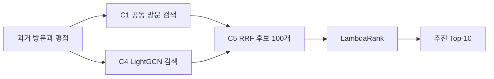

# Rating Recommender System

[English](./README.md)

DiningCode의 방문·평점·리뷰를 이용해 **사용자가 만족할 식당을 찾는 방법**을 비교하는 연구 프로젝트다.

갱신: **2026-10-13 KST**

현재 기준 모델은 방문·평점만 사용한다. 리뷰를 활용한 여러 실험은 완료했지만 안정적인 추가 이득을 확인하지 못해 기준 모델에는 반영하지 않았다.

## 문서 안내

1. 연구 계획·진행 상황

   - [PLAN.md](./PLAN.md)
   - 완료한 실험, 현재 판단, 다음 작업

2. 기준 모델 정의

   - [BASELINE_MODEL.md](./BASELINE_MODEL.md)
   - 입력, 후보 검색, 재정렬, 학습·평가 규칙

3. 실험 결과

   - [reports/README.md](./reports/README.md)
   - 방법별 결과, 한계, 원본 artifact

4. 만족도 정답

   - [SATISFACTION_BASELINE.md](./SATISFACTION_BASELINE.md)
   - 사용자별 강한·약한 만족 기준

5. 로컬 자료

   - [artifacts/README.md](./artifacts/README.md)
   - 모델, 캐시, 원문, ZIP의 보존·복원 범위

## 현재 시스템

전체 식당을 한 번에 정교하게 평가하면 계산량이 커지므로 검색과 재정렬을 나눈다. 먼저 행동 이력으로 후보 100개를 찾고, 그 안에서 더 많은 feature를 사용해 Top-10 순서를 정한다. 이 구분 덕분에 후보를 못 찾은 문제와 후보 순서를 잘못 정한 문제를 따로 분석할 수 있다.



1. 후보 검색

   - C1: 함께 방문된 식당 관계
   - C4: 사용자–식당 방문 그래프의 LightGCN
   - C5: C1과 C4 순위의 RRF 결합
   - 이미 방문한 식당을 제외하고 최대 100개 생성

2. 재정렬

   - LightGBM LambdaRank
   - 방문·평점·지역 등 16개 feature
   - 최종 Top-10 출력

3. 리뷰와 메뉴

   - 리뷰: 별도 실험 완료, 기준 모델에는 미사용
   - 메뉴·외부 식당 정보: 추천 효과 미검증

4. 현재 연구 범위

   - 리뷰 텍스트를 이용한 전체 식당 후보 검색 개선
   - 재정렬 후속 연구는 현재 보류

Two-stage는 후보 검색과 재정렬을 나누는 전체 구조다. Two-Tower는 사용자와 식당을 따로 인코딩하는 모델 구조다. 시간 분할과 순차 추천도 별개의 실험 축이다.

## 데이터와 평가

추천 시점에 실제로 알 수 있었던 정보만 입력으로 사용하기 위해 시간을 기준으로 데이터를 나눈다. 같은 사용자의 미래 리뷰나 평점을 과거 프로필에 넣지 않으며, 미래 방문은 모델이 맞혀야 할 정답으로만 사용한다.

1. 고정 데이터

   - Snapshot: `e7896add5b4b5939`
   - 첫 사용자–식당 상호작용: 88,554개
   - 사용자: 14,008명
   - 식당: 4,587곳

2. 시간 분할

   - Train: 70,883개, 2025-12-19(T1)까지
   - Validation: 8,934개, T1 이후 2026-05-04(T2)까지
   - Test: 8,737개, T2 이후 약 145일
   - 미래 리뷰·평점은 입력에서 제외하고 정답으로만 사용

3. 평가 사용자

   - Validation: 과거 이력과 관련 정답이 있는 1,639명
   - Test: 과거 이력과 관련 정답이 있는 1,573명
   - 과거 이력이 없는 신규 사용자는 현재 개인화 평가에서 제외
   - Catalog 밖 정답은 Recall 분모에 유지

4. 주요 지표

   - 후보 검색: Recall@100
   - 전체 시스템: Graded NDCG@10
   - 정답: 미래 실제 방문의 개인별 만족도 등급 0/1/2
   - 관련 정답 경계: 3점 이상

## 기준 성능

2026-10-04 Window/history-aware, seed 42의 test 결과다. 아래 값은 2026-10-12 오류 수정 전 모델에서 측정했다.

1. 후보 검색

   - C5 Recall@100: **20.1626%**
   - C5 후보 순서 NDCG@10: **0.026590**

2. 최종 재정렬

   - LambdaRank NDCG@10: **0.025467**
   - LambdaRank Recall@10: **3.6502%**

3. 판단

   - 이번 test에서 LambdaRank의 추가 이득은 확인되지 않았다.
   - 이후 리뷰 실험도 기준 모델에 채택하지 않았다.
   - 10월 12일 수정 후 실데이터 재학습·재평가는 아직 없다.

근거는 [기준 실행 보고서](./artifacts/runs/20261004T125314601899Z-e7896add/report.md)와 [baseline 진단](./reports/baseline.md)에 있다.

## 실험 이력

실험은 모델 이름보다 검증하려는 질문에 따라 묶었다. 텍스트 단독 검색, 행동 모델과의 결합, 여러 리뷰의 집계 방식, 같은 구조에서의 텍스트 추가효과는 서로 다른 질문이므로 결과도 구분해서 읽어야 한다.

1. 어휘·의미 검색

   - DeepCoNN, BM25, Liquid, E5 평균 검색
   - 단독 검색과 C5 결합 모두 기준 모델보다 낮거나 개선 불확실

2. 리뷰 입력 모델

   - E5 6피처 LambdaRank
   - E5 Two-Tower
   - 리뷰 Transformer와 Top-200 cross-attention
   - 안정적인 추가 이득 미확인

3. 행동 모델과 텍스트 결합

   - RLMRec/E5 정렬
   - 속성·감정 10채널
   - 고정 텍스트 식당 그래프
   - 행동 기준을 안정적으로 개선하지 못함

4. 다중 리뷰·취향 표현

   - 리뷰별 Top-3 matching
   - 취향 K1/K3
   - 학습형 mean/late/shuffle
   - 텍스트 단독 신호는 있었지만 C5 보완 효과는 미확인

5. 통제 비교

   - 같은 Two-Tower의 행동/행동+E5, 3seed×12epoch
   - 행동 그래프/텍스트 그래프/학습형 리뷰 검색, 3seed
   - 텍스트 추가효과의 신뢰구간이 대부분 0을 포함

6. 데이터·표현 진단

   - 리뷰 길이·평점·희소성 조사
   - LLM 속성·감정 추출 진단
   - RQ-VAE 리뷰 코드와 이웃 보존 평가

상세 진행 순서는 [PLAN의 실험 이력](./PLAN.md#실험-이력), 수치와 비교 조건은 [리뷰 임베딩 리포트](./reports/review_embeddings.md)를 따른다.

## 코드 수정

2026-10-12에 다음 6개 오류를 수정했다.

오류 수정은 구현을 평가 정의와 맞춘 작업이다. 수정 자체가 추천 성능 개선을 뜻하지 않으므로 기존 artifact는 과거 기록으로 보존하고, 성능 영향은 별도 재학습으로 확인해야 한다.

1. 의견 추출의 간접 부정 범위
2. E5 formatter의 최소 토큰 예산과 역할 접두어
3. 그래프·리뷰 epoch 차이의 샘플 검증
4. BM25 품사 필터의 부정 표현
5. Two-Tower 미참여 ID의 추론 처리
6. LambdaRank early stopping의 전체 정답 IDCG와 사용자 분모

- 전체 테스트: **512 passed, 1 skipped**
- 기존 artifact와 성능: 수정 전 결과로 보존
- 수정 후 실데이터 성능: 미측정

## 실행 방법

명령은 `projects/rating_recsys`에서 실행한다.

1. 입력·캐시 점검

   ```bash
   .venv/bin/python -m rating_recsys.experiments.review_ltr \
     --snapshot artifacts/snapshots/e7896add5b4b5939.jsonl --dry-run
   ```

   - 새 학습 없음
   - 누락 임베딩 추론 없음
   - 저장된 E5 프로필과 캐시 조건 확인

2. 기준 모델 재학습

   ```bash
   .venv/bin/python -m rating_recsys.experiments.cli \
     --snapshot artifacts/snapshots/e7896add5b4b5939.jsonl \
     --ranker-training-mode window --satisfaction-mode history-aware \
     --satisfaction-min-history 10 --label window-personal-satisfaction-n10
   ```

3. Two-Tower 텍스트 통제 비교

   ```bash
   .venv/bin/python -m rating_recsys.experiments.two_tower_ablation_cli \
     --epochs 12 --seeds 42 43 44 --threads 4
   ```

   - Validation 전용
   - 행동 입력과 학습 조건 고정
   - E5 입력만 0/실제 값으로 변경

4. 텍스트 그래프·리뷰 검색 비교

   ```bash
   .venv/bin/python -m rating_recsys.experiments.text_retrieval_comparison_cli \
     --seeds 42 43 44 --graph-epochs 20 --review-epochs 12 --threads 4
   ```

   - Validation 전용
   - 텍스트 그래프와 재배선 대조
   - mean/late/shuffle 비교

5. 환경 준비

   ```bash
   conda create --prefix ./.venv python=3.10 pip libgomp -y
   conda activate ./.venv
   pip install -e '.[experiment,dev]'
   ```

   - DeepCoNN·PyTorch: `deepconn`
   - 로컬 E5: `local-embeddings`
   - BM25·한국어 토큰화: `bm25`
   - RQ-VAE: `rqvae`

6. 테스트

   ```bash
   .venv/bin/python -m pytest -q
   .venv/bin/python -m rating_recsys.experiments.compare_cli --help
   ```

## 저장소 구조

1. 코드

   - `src/rating_recsys/`: 데이터, 검색, 순위 학습, 평가
   - `tests/`: 회귀·통합 검증

2. 문서

   - `PLAN.md`: 연구 계획과 진행 상황
   - `BASELINE_MODEL.md`: 기준 모델 정의
   - `reports/`: 방법별 결과와 해석

3. 실행 자료

   - `artifacts/snapshots/`: 고정 입력
   - `artifacts/prepared/`: 재사용 후보·학습 행
   - `artifacts/runs/`, `artifacts/comparisons/`: 설정·모델·순위·지표
   - `artifacts/local_models/`, E5 SQLite cache: 동결 모델·임베딩

4. 수집·적재

   - `crawler/`: 데이터 수집
   - `migrations/`: DB schema
   - `queries/`: 검증 SQL

문서는 [docs_style.md](./docs_style.md)를 따른다. API 응답·원문·모델·ZIP은 로컬 자료이며 보존 상태는 [artifacts/README.md](./artifacts/README.md)에 기록한다.
